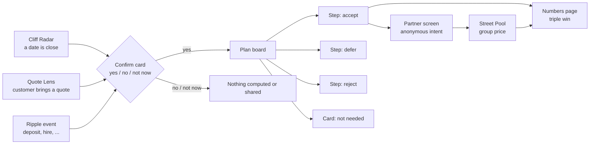
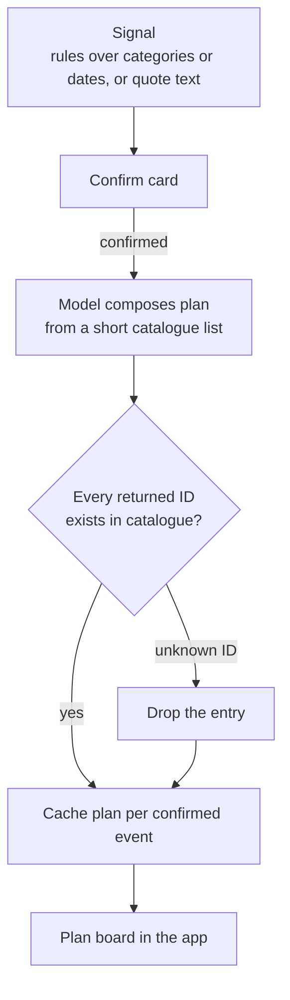

# Brainstorm (merged)

Single working document for the KBC challenge. It merges `brainstorm.md` and `new-ideas.md`. The ideas below do not use the KBC ecosystems spreadsheet.

## 1. What the jury wants

The brief asks for a scalable ecosystem that moves a customer from intent to action, before the customer realises they need help. The customer stays in control, partners get something out of it, and KBC can measure the result. Creativity and pitch quality are 25% each, so the idea has to be easy to explain and different from what the other 15 KBC teams will show.

| Brief requirement | How we answer it |
|---|---|
| Before the customer realises | Entry by calendar (Cliff Radar) or by a document the customer brings (Quote Lens) |
| Customer in control | Confirm card first, step-by-step approval, data-used line on every card |
| Partners get something | Anonymous confirmed intent, group volume (Street Pool) |
| KBC can measure | Triple-win page: customer savings, KBC revenue, qualified leads per partner |
| Scalable | Rules detect, the model only writes the plan from a fixed catalogue |

## 2. All ideas at a glance

| Idea | Signal | Strength | Weakness | Status |
|---|---|---|---|---|
| Ripple | Confirmed life event | One event becomes one plan across domains | Can look like another recommender | Engine |
| First Hire | Payroll payment | Business and private side in one view | Narrower audience | Candidate second scenario |
| Trip Autopilot | Flight payment | Easy demo | Most likely pick for other teams | Out |
| Intent Exchange | Confirmed intent | Partner side is a real product | Needs partners to look real | Folded into Ripple as partner screen |
| Quote Lens | A quote the customer brings | No transaction data, price check builds trust | Needs a market price reference | Entry door |
| Cliff Radar | A date (contract or rate ending) | Deterministic, cheap, measurable | Less emotional | Entry door |
| Street Pool | Same intent across neighbours | Volume for partners, price drops with each member | Hard to show live | Partner side / vision slide |
| Soft Landing | Income drop | Strong story | Sensitive, no lead value | Parked |
| Heir Desk | Death in the family | Nobody else will pick it | Heavy for 3 minutes | Parked |
| Season Switch | Seasonal business calendar | Reuses First Hire | Similar to First Hire | Parked |

Descriptions of the parked and out ideas:

- **Trip Autopilot.** A flight payment triggers travel insurance, an eSIM, airport fast lane, parking and currency.
- **Soft Landing.** An income drop leads to paused instalments, renegotiation, fewer subscriptions and a pointer to benefits.
- **Heir Desk.** One event starts notary, succession, accounts, utilities and insurance.
- **Season Switch.** A shop, restaurant or campsite prepares for peak season: stock, staff, insurance, cash buffer.

## 3. Direction: Ripple with three entry doors

Ripple is the engine. A life event confirmed by the customer fans out across several KBC domains and becomes one plan, approved step by step. Three different signals can start it.



KBC acts as the customer's agent. Partners receive a confirmed, anonymous intent and never customer data.

### Worked story: Sofie

1. **Cliff Radar opens it.** Sofie's energy contract ends in 60 days and her home has no solar. A card asks whether she wants to look at options. Nothing happens until she answers.
2. **Quote Lens qualifies it.** She uploads the quote she already has from an installer. KBC reads it, shows that it sits 12% above the going rate and lists what it leaves out (battery, insurance, subsidy).
3. **Street Pool closes it.** 38 anonymous neighbours in her area have the same confirmed intent. The group price is below her quote. She can join, keep her own installer, or reject.
4. **The rest ripples out.** Electricity setup, charging point, insurance and a loan if she wants one, each as a step on the board.

### Rules of the design

1. Confirm the signal first. Nothing is computed or shared until the customer confirms. This answers "you watched my transactions?" before it is asked.
2. Every plan includes at least one "not needed" card, based on what the customer already has. A bank that tells you not to buy something is the strongest trust signal we can show.
3. The plan is a board of steps, not a chat. Each step can be accepted, deferred or rejected, and shows why it appears and which data it used.
4. The partner view is a real screen. An installer sees "Solar, Ghent region, Q4, budget band B" and no name.
5. A numbers page shows the triple win: customer savings, what KBC earns and keeps, qualified leads per partner. Assumptions sit on one slide.
6. Second scenario, same engine, different signal. No third scenario.

### What each piece adds to the pitch

| Piece | Jury question it answers | Answer |
|---|---|---|
| Cliff Radar | How do you know before I do? | From a date, not from watching transactions |
| Quote Lens | Why should I trust you? | KBC tells me my price is too high |
| Street Pool | What do partners get? | Volume instead of leads |

## 4. Engine



- Signals come from deterministic rules over transaction categories and dates. Cheap, auditable, and it scales.
- A language model composes the plan, but only from a short list of catalogue entries it is given. Every ID it returns is checked against the catalogue and anything unknown is dropped.
- Plans are generated once per confirmed event, then cached. The demo scenarios are precomputed, with a live regenerate button as an extra.
- Quote reading: a precomputed demo file first, a live upload as an extra.
- Data is synthetic. We say so on the slide.

## 5. Screens

```
Confirm card                         Plan board
+------------------------------+     +--------------------------------------------+
| Your energy contract ends    |     | Sofie, solar and energy                    |
| in 60 days. Look at options? |     |                                            |
|                              |     | [Check quote]  [Join group]  [Battery]     |
| [ Yes ] [ No ] [ Not now ]   |     |  accept/defer   accept/defer  accept/defer |
| Data used: contract end date |     |  why + data     why + data    why + data   |
+------------------------------+     |                                            |
                                     | [Home insurance]  NOT NEEDED               |
Partner screen                       |  you already have this cover               |
+------------------------------+     +--------------------------------------------+
| Solar, Ghent region          |
| Q4, budget band B            |     Numbers page
| 38 homes in the pool         |     +--------------------------------------------+
| Group price offer: [ ... ]   |     | Customer saves   KBC earns   Leads/partner |
| No name, no customer data    |     | Assumptions on one slide                   |
+------------------------------+     +--------------------------------------------+
```

## 6. Pitch outline (3 minutes)

1. Fifteen seconds on one person: Sofie, her contract ending, a quote in her inbox.
2. The confirm card, then the quote check, then the ripple across three ecosystems.
3. She rejects one step, defers one, and one card says "not needed". The plan still works.
4. The partner screen with the group of neighbours.
5. The numbers page.
6. Ten seconds on the second scenario: same engine, different signal.
7. Close: KBC stops being the shop and becomes the customer's agent.

## 7. Open points

- Which entry is shown live and which is only a slide. Current lean: Quote Lens live with a preloaded file, Cliff Radar as the opening card, Street Pool on the partner screen with fixed numbers.
- Second scenario: First Hire, or Cliff Radar on a business (insurance or lease ending).
- Source of the market price range. Needs a synthetic reference table and a note on the slide.
- Whether Street Pool counts are real aggregates over the synthetic customers or a fixed demo number.

## 8. Risks

| Risk | Mitigation |
|---|---|
| Looks like another recommender | Partner screen, "not needed" card, board layout, quote price check |
| Privacy questions in Q&A | Confirm step and data-used line on every card |
| Invented services | Catalogue-only output with validation |
| Too much for 3 minutes | One story, three doors, one live path |
| Demo on a machine we do not control | Public URL, cached scenarios, recorded fallback finished by 15:00 |
| Scalability questions | Rules detect, the model only writes the plan |
| Security score | Aikido connected early, minimal dependencies, API key only on the server, rate limits on public endpoints |

## 9. Schedule

| Time | Milestone |
|---|---|
| 09:30 | Repository connected to Aikido |
| 13:30 | Scope freeze |
| 14:00 | Aikido findings fixed |
| 15:00 | Fallback video recorded |
| 15:30 | Submission on Builderbase, half an hour before the deadline |
